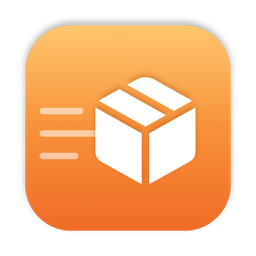
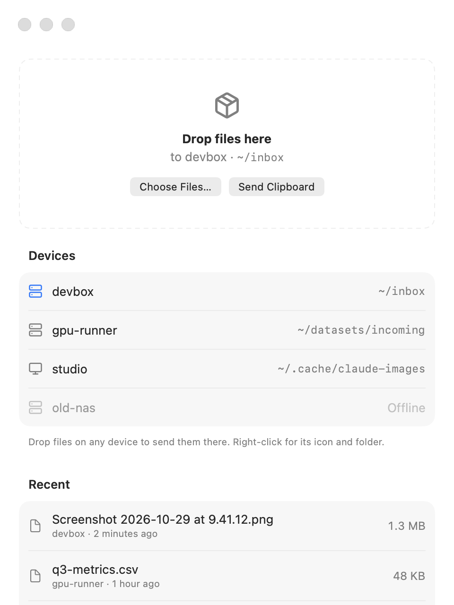
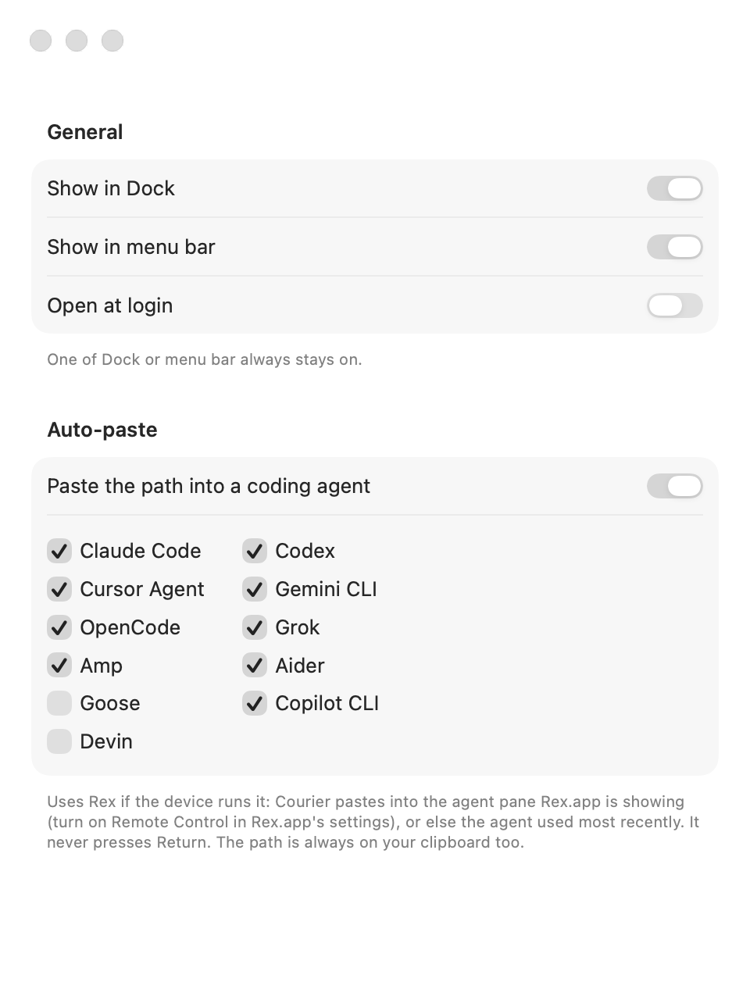

#  Courier

Courier sends files from your Mac to another machine and gives your coding agent the path.

> [!NOTE]
> This is a hacked-together project I built for my own use. It works on my setup, but expect rough edges, and don't rely on it for anything important.

If you run Claude Code on a remote box, you can't drag a screenshot into it, because the file is on your Mac. Drop it on Courier instead. It copies the file over SSH and pastes the path into your agent, or puts it on your clipboard.

<table>
  <tr>
    <td width="50%">
      <picture>
        <source media="(prefers-color-scheme: dark)" srcset="docs/screenshots/home-dark.png">
        
      </picture>
    </td>
    <td width="50%">
      <picture>
        <source media="(prefers-color-scheme: dark)" srcset="docs/screenshots/settings-dark.png">
        
      </picture>
    </td>
  </tr>
</table>

## Setup

You need macOS 14 or later and [Tailscale](https://tailscale.com) on your Mac and on the machines you send to. You also need SSH access to those machines without a password. The easiest way is to run `sudo tailscale set --ssh` on each one. If `ssh <machine> true` works without asking you anything, you're set.

Then build and install:

```sh
git clone https://github.com/abhi-reducto/courier.git
cd courier
./install.sh
```

A box icon appears in your menu bar. You can also ask Claude Code or Codex to clone the repo, read `AGENTS.md`, and run `./install.sh` for you.

## Use

Drag files onto the menu bar icon or into the Courier window. To send a screenshot, copy it with ⌘⇧⌃4 and choose Send Clipboard. Click a machine in the window to send there, and click its folder to change where files go.

When a file arrives, its path is copied to your clipboard.

## Rex

If the machine runs [Rex](https://docs.superlogical.com), Courier pastes the path straight into your agent's terminal. Add the machine as a Rex host with the same name it has in Tailscale, and turn on Remote Control in Rex.app's settings. Courier pastes the path but never presses Return.

## Problems

Most errors come from SSH. Run `ssh <machine> true` in Terminal and fix whatever it complains about. Courier logs to `~/Library/Logs/Courier.log`.

To change Courier, see [`AGENTS.md`](AGENTS.md). Icons are from [Lucide](https://lucide.dev).
