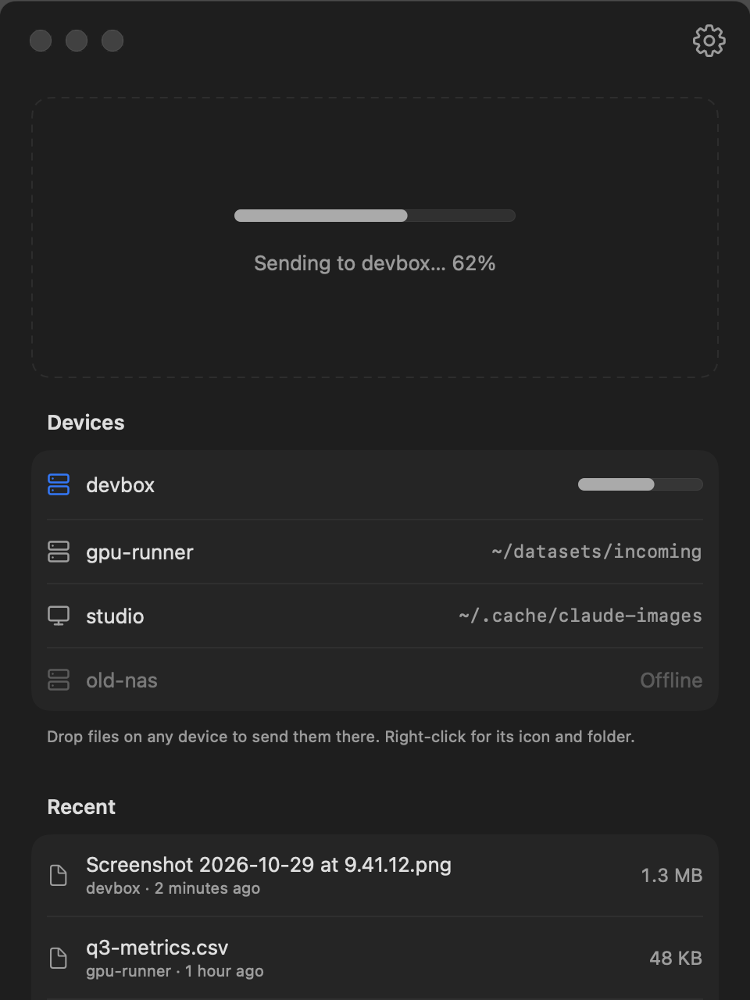

#  Courier

Send files from your Mac to any machine on your Tailscale network, and have the path land in the coding agent you're running there.

Drop a screenshot, a CSV, or a whole folder on Courier. It copies it to the folder you picked on that machine over SSH, puts the remote path on your clipboard, and, if the machine runs [Rex](https://docs.superlogical.com), pastes the path straight into your Claude Code, Codex, or Cursor Agent prompt.

<table>
  <tr>
    <td width="50%">
      <picture>
        <source media="(prefers-color-scheme: dark)" srcset="docs/screenshots/home-dark.png">
        
      </picture>
    </td>
    <td width="50%">
      <picture>
        <source media="(prefers-color-scheme: dark)" srcset="docs/screenshots/settings-dark.png">
        
      </picture>
    </td>
  </tr>
</table>

## Why

When Claude Code runs on a remote box, pasting or dragging an image into it does nothing: the file and the clipboard are on your Mac. Claude Code reads any file path you put in a prompt, so all it needs is the file on that machine and its path. Courier does both in one drop.

## What it does

- **Menu bar and window.** Drop files on the menu bar icon, or open the Courier window and drop them on the big area or straight onto any device in the list.
- **Any file or folder.** Images, CSVs, PDFs, whole folders. Folders are sent as they are. The clipboard works too: files copied in Finder, or an image such as a screenshot taken with ⌘⇧⌃4.
- **A folder per device.** Each device remembers where files go (`~/inbox`, `/tmp/drops`, …). Missing folders are created. A name that's already taken becomes `name (1).ext`, `name (2).ext`.
- **Progress and history.** The menu bar icon fills as it uploads, then shows a check. The window lists recent sends with sizes; click one to copy its path.
- **Auto-paste into agents** on machines running Rex: Claude Code, Codex, Cursor Agent, Gemini CLI, OpenCode, Grok, Amp, Aider, Goose, Copilot CLI, Devin. It never presses Return.

## Requirements

- macOS 14 or later, with the Xcode Command Line Tools (`xcode-select --install`). No full Xcode needed.
- [Tailscale](https://tailscale.com) on your Mac and on the machines you send to. Courier lists your devices from it.
- SSH from your Mac to each machine you send to, without a password prompt. Either:
  - **Tailscale SSH** (simplest): on the machine, run `sudo tailscale set --ssh` and allow it in your tailnet's access rules. Nothing else to set up.
  - **Regular SSH keys**: if a machine needs a particular user or key, add a `Host` entry to `~/.ssh/config` named the same as its Tailscale name. Courier uses that entry.

  Check it with `ssh <device-name> true`. If that works without asking anything, Courier will too.
- Optional: [Rex](#with-rex), for pasting paths into your agent.

## Install from source

### Build it yourself

```sh
git clone https://github.com/abhi-reducto/courier.git
cd courier
./install.sh
```

`install.sh` compiles the app with `swiftc`, builds its icon, and installs:

- `~/Applications/Courier.app`
- `~/.local/bin/rimg`, the uploader the app runs (also usable from a terminal)
- `~/.local/bin/rex-paste`, which finds the agent terminal in Rex

Look for the tray icon in your menu bar. Because you built it yourself, macOS doesn't block it, so no signing or notarization is involved. Run `./install.sh` again after pulling changes.

### Have a coding agent build it

Open Claude Code, Codex, or another coding agent in an empty folder and paste:

> Clone https://github.com/abhi-reducto/courier (private; use `gh repo clone abhi-reducto/courier` if plain git can't authenticate). Read AGENTS.md, then run ./install.sh. If the build fails, fix the cause, not the symptom, and tell me what you changed. When it's installed, check that `ssh <device> true` works for the device I want to send to, which is: ___. Then tell me how to open Courier.

The repo's [`AGENTS.md`](AGENTS.md) (also read by Claude Code through `CLAUDE.md`) explains the layout, the build, how to check UI changes without a screen recording, and the pitfalls already hit, so an agent can also change Courier for you.

## First run

1. Click the tray icon in the menu bar. Your Tailscale devices are listed under **Send to**; pick one.
2. Allow notifications when macOS asks. Courier uses them to say when a send finished or failed.
3. Open **Open Courier…** to set each device's folder: click the folder next to a device, or right-click the device. The default is `~/.cache/claude-images`.
4. Optional: in **Settings** (the gear, or ⌘,) turn on **Open at login**, or move Courier from the menu bar to the Dock.

## Using it

| To send | Do this |
|---|---|
| Files or folders | Drag them onto the menu bar icon, the window's drop area, or a device in the window's list |
| A screenshot | Take it to the clipboard (⌘⇧⌃4), then **Send Clipboard** |
| Files copied in Finder | ⌘C them, then **Send Clipboard** |
| Files you pick | **Select Files…** in the menu, or **Choose Files…** in the window |

The selected device (accent-colored in the window, checked in the menu) is where the menu bar and the drop area send. After a send, the remote path is on your clipboard; paste it into your agent with ⌘V. With Rex it's already pasted for you.

<p align="center"></p>

## With Rex

[Rex](https://docs.superlogical.com) is a terminal multiplexer with Tailscale built in. If the machine you send to runs a Rex server, Courier pastes the file path into the terminal that's running your coding agent, so you only have to type your question.

**Setup:**

1. On your Mac, add the machine as a Rex host (`rex hosts add`, or Rex.app → Add Remote Host). Give it the same label as its Tailscale name or its `~/.ssh/config` alias, so Courier can match the two. Courier also matches a Rex server whose Tailscale device is named `rex-<device>`.
2. For the best targeting, turn on **Remote Control** in Rex.app → Settings → Rex Server. Courier then asks Rex.app which pane you're looking at.
3. In Courier's Settings, keep **Paste the path into a coding agent** on and tick the agents you use.

**Which terminal gets the path:**

1. The pane Rex.app is showing, if it's running one of the ticked agents (needs Remote Control).
2. Otherwise, the agent terminal that's focused in its session and reported activity most recently.
3. If no agent terminal is found, nothing is pasted. The path is still on your clipboard.

Courier pastes; it never presses Return. Rex also isn't used for the upload itself, which always goes over SSH.

## Without Rex

Everything works the same, except the path isn't pasted for you: it's on your clipboard, so ⌘V it into your agent. You can turn auto-paste off in Settings to skip looking for Rex.

## From the terminal

`rimg` is the uploader behind the app, and it works on its own:

```sh
RIMG_HOST=devbox rimg                  # send the clipboard image
RIMG_HOST=devbox rimg shot.png data/   # send files or folders
```

| Variable | Meaning |
|---|---|
| `RIMG_HOST` | SSH host to send to (required) |
| `RIMG_DIR` | Remote folder: absolute, `~/…`, or relative to home. Default `.cache/claude-images` |
| `RIMG_REX` | Rex host label to paste the path into. Defaults to `RIMG_HOST`; empty skips pasting |
| `RIMG_AGENTS` | Comma-separated agents to paste into, e.g. `claude,codex`. Default: all |

It prints each remote path and copies them to your clipboard.

## What can be sent

Anything. A few details:

- Clipboard images are saved as PNG. Drag the original file to keep its format.
- A single executable file arrives without its executable bit (`chmod +x` it); inside a folder it keeps it.
- Mac-only metadata (tags, resource forks) is dropped.
- Whether your agent can read the file is up to the agent. Claude Code reads text of any kind (CSV, JSON, code, logs), PNG/JPEG/GIF/WebP images, PDFs, and notebooks directly. For Excel, Word, HEIC, audio, or video it needs a tool on that machine (pandas, pandoc, ffmpeg).

## Troubleshooting

| Courier says | What to do |
|---|---|
| Couldn't reach *device* | Check it's online in Tailscale and SSH is on (`ssh <device> true`). |
| *device* turned down the SSH login | Your key isn't accepted there. Set up Tailscale SSH or add your key to the machine. |
| SSH doesn't trust *device* yet | Run `ssh <device>` once in Terminal and accept its host key. |
| Nothing to send | The clipboard has no image or Finder files. Copy one first. |
| Path copied, paste with ⌘V | No agent terminal was found in Rex, or auto-paste is off. See [With Rex](#with-rex). |

- **No devices listed:** Courier looks for the Tailscale CLI in `/usr/local/bin`, `/opt/homebrew/bin`, and inside `Tailscale.app`. Make sure Tailscale is running.
- **Open at login doesn't stick:** toggle it off and on once in Settings after reinstalling.
- **Logs:** `~/Library/Logs/Courier.log`.

## How it works

```
Courier.app ──runs──▶ rimg ──ssh──▶ device: writes the files into your folder
     │                  │
     │                  └──▶ rex-paste ──Rex API──▶ pastes the path into the agent's terminal
     └── Tailscale CLI: device list
```

`rimg` streams each file over one shared SSH connection, reporting progress to the app as it goes. On the device, it claims a free name (`name`, `name (1)`, …) atomically before writing, so two sends can't collide.

## Development

See [`AGENTS.md`](AGENTS.md) for the file layout, conventions, and how to check UI changes. In short: edit, run `./install.sh`, and regenerate the screenshots with `scripts/screenshots.sh` (it uses demo devices, never your real ones).

## Credits

Interface icons are from [Lucide](https://lucide.dev) (ISC license, see `icons/LICENSE`). The menu bar tray uses Apple's SF Symbol `tray.and.arrow.down`, and the app icon is drawn around `shippingbox.fill`.
